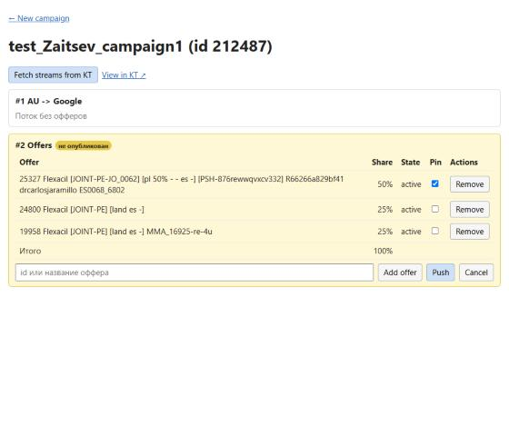

# Keitaro wrapper

Тестовое задание Adrobot: обёртка над Admin API рекламного трекера Keitaro на FastAPI + SQLAlchemy.

1. **Создаватор кампаний.** Принимает название, гео и оффер и создаёт в Keitaro кампанию с доменом, группой, источником и двумя потоками:
   - поток 1: страна из Geo → редирект на `https://google.com`;
   - поток 2: все остальные → выбранный оффер.
2. **Редактор кампании.** Повторяет логику эталонной обёртки из видео.
   - Fetch забирает потоки из Keitaro.
   - Офферы добавляются и удаляются как черновик.
   - Push публикует изменения в Keitaro, Cancel откатывает их.
   - Удалённые офферы попадают в архив с кнопкой Bring back.
   - Доли можно закреплять (Pin), остальные пересчитываются, сумма всегда 100%.



## Быстрый старт

Нужен Python 3.11+ и API-ключ Keitaro (админка → Профиль → API ключи).

```bash
python -m venv .venv
# Windows:
.venv\Scripts\activate
# Linux / macOS:
source .venv/bin/activate

pip install -r requirements.txt
cp .env.example .env        # Windows: copy .env.example .env
```

Впишите ключ в `.env` (`KEITARO_API_KEY=...`), затем:

```bash
alembic upgrade head        # создаёт app.db (SQLite) со всеми таблицами
uvicorn app.main:app --reload
```

Откройте http://localhost:8000.

## Настройки (`.env`)

| Переменная | По умолчанию | Что это |
|---|---|---|
| `KEITARO_URL` | `https://keitaro.example.com` | адрес трекера |
| `KEITARO_API_KEY` | — | ключ Admin API, **обязателен** |
| `NAME_PREFIX` | `test_Zaitsev_` | префикс имён кампаний; менять разрешено только кампании с ним |
| `DATABASE_URL` | `sqlite:///./app.db` | любая строка подключения SQLAlchemy |
| `DEFAULT_DOMAIN_ID` | `1` | домен новой кампании (`example.com`) |
| `DEFAULT_GROUP_ID` | `2` | группа (`FORTESTS`) |
| `DEFAULT_SOURCE_ID` | `3` | источник трафика (`FORTESTS`) |
| `ALLOWED_HOSTS` | `["localhost","127.0.0.1"]` | на какие `Host` отвечает приложение (JSON-список); защита от DNS rebinding |

Id домена, группы и источника на другом трекере можно узнать командой `python scripts/recon.py`. Скрипт делает только GET-запросы и сохраняет справочники в `tests/fixtures/`.

## Миграции

Схема БД управляется Alembic, адрес базы берётся из `DATABASE_URL`.

```bash
alembic upgrade head                                  # применить все миграции
alembic downgrade -1                                  # откатить последнюю
alembic revision --autogenerate -m "описание"         # новая миграция после правки app/models.py
```

| Миграция | Что делает |
|---|---|
| `327061f53e68_initial_schema` | таблицы `campaigns`, `streams`, `offers`, `stream_offers` |
| `b2b21076355e_streams_schema` | колонка `streams.schema` (поток с офферами или нет) |

## Тесты

```bash
python -m pytest
ruff check .
```

Тесты не обращаются к настоящему Keitaro: HTTP мокается через `respx`, БД поднимается в памяти. Сценарий из видео целиком прогоняется в `tests/test_editor.py::test_video_scenario`.

## Как пользоваться

**Создание** (`/`):
1. Введите имя: префикс добавится сам, `campaign1` станет `test_Zaitsev_campaign1`.
2. Введите Geo: одну страну или несколько через запятую, например `AU` или `MX,AU,RO`.
3. Выберите оффер из автокомплита и нажмите Create.

Если поток не создался, кампания отправляется в архив Keitaro, чтобы в общем трекере не оставалось мусора.

**Редактор** (`/campaigns/{id}`, ссылки есть на главной):

| Кнопка | Что происходит |
|---|---|
| Fetch streams from KT | Потоки и офферы загружаются из Keitaro. Поток без офферов показывается только именем. Оффер, который был у нас, но исчез из Keitaro, становится серым (`removed`). Неопубликованные правки сбрасываются |
| Add offer | Оффер добавляется только у нас, доли пересчитываются (4 оффера → по 25%), поток желтеет |
| Remove | Оффер серый, 0%, остальные пересчитываются. После Push он исчезает из Keitaro, но остаётся у нас в архиве |
| Bring back | Возвращает оффер из архива, доли пересчитываются |
| Pin | Фиксирует текущую долю. При следующих пересчётах она не меняется, остаток делится между незакреплёнными |
| Push | Отправляет офферы потока в Keitaro. Только для кампаний с префиксом и только при сумме 100% |
| Cancel | Возвращает поток к опубликованному состоянию, добавленные после публикации офферы удаляются |
| View in KT | Открывает кампанию в админке Keitaro |

## Как устроено

```
app/
  main.py         # FastAPI, страницы, защита POST от чужого Origin
  config.py       # настройки из .env (pydantic-settings)
  db.py           # engine, сессия, Base с naming convention для Alembic
  models.py       # Campaign, Stream, Offer, StreamOffer
  keitaro.py      # клиент Admin API (httpx); ошибки Keitaro → HTTP 502 с текстом
  services.py     # создаватор кампаний
  editor.py       # редактор: rebalance, fetch, add/remove/restore/pin, push, cancel
  routers/api.py  # JSON API
  templates/      # index.html (vanilla JS), editor.html (jQuery)
alembic/          # миграции
scripts/recon.py  # разведка справочников Keitaro (только GET)
tests/
```

**Модель данных.** `stream_offers` хранит две пары полей:
- текущее состояние (`share`, `state`) — это черновик;
- опубликованное в Keitaro (`pub_share`, `pub_state`).

Поток «жёлтый», если они расходятся. Cancel копирует опубликованное в текущее, Push — наоборот. `pub_state = NULL` значит, что оффер ни разу не публиковался, и Cancel удаляет такую строку. `offers` — справочник офферов, которые встречались в наших потоках. Это не кэш: автокомплит всегда ищет в Keitaro, как в эталоне.

**JSON API.** Все операции редактора возвращают кампанию целиком.

| Метод | Путь | Что делает |
|---|---|---|
| GET | `/api/offers?q=` | поиск офферов в Keitaro |
| POST | `/api/campaigns` | создать кампанию `{name, geo, offer_id}` |
| GET | `/api/campaigns/{id}` | кампания из БД |
| POST | `/api/campaigns/{id}/fetch` | загрузить из Keitaro |
| POST | `/api/streams/{id}/offers` | добавить оффер `{offer_id}` |
| POST | `/api/streams/{id}/push`, `/cancel` | опубликовать / откатить |
| POST | `/api/stream_offers/{id}/remove`, `/restore` | убрать / вернуть |
| POST | `/api/stream_offers/{id}/pin` | закрепить `{pinned: true}` |

Документация Swagger: http://localhost:8000/docs.

## Решения и допущения

- **Geo.** В ТЗ сказано «гео-код страны», а в эскизе формы — `MX,AU,RO,...`. Принимается список через запятую, он идёт в один фильтр `country`; одна страна при этом тоже работает.
- **Формат потоков** сверен с документацией и с потоками, созданными через API. Оба потока имеют тип `regular`, у первого `schema: redirect`, `action_type: http`, у второго `schema: landings`.
- **Alias кампании** обязателен в API, генерируется случайно (8 символов).
- **`PUT /streams/{id}` с `offers` заменяет весь список** (проверено на реальном потоке), поэтому Push отправляет все активные офферы.
- **Пересчёт долей.** Доли целые. Остаток от деления раздаётся по 1% последним офферам: 3 → 33/33/34, 7 → 14×5/15/15. Pin сам доли не пересчитывает, Remove снимает закрепление.
- **Безопасность общего трекера.** Push разрешён только для кампаний с `NAME_PREFIX`, чужие кампании открываются на просмотр. Авторизации в приложении нет, поэтому есть две защиты. POST-запросы с чужим `Origin` отклоняются (CSRF). Запросы с `Host` не из `ALLOWED_HOSTS` тоже отклоняются (DNS rebinding).
- **Колонка Trends** с кадра видео не сделана: в описании логики её нет.

## Разработка

Проект сделан с ИИ-агентом Claude Code. Контекст для агента лежит в [CLAUDE.md](CLAUDE.md): правила, команды, ловушки API. План, разведка API и спецификация редактора описаны в [PLAN.md](PLAN.md).
